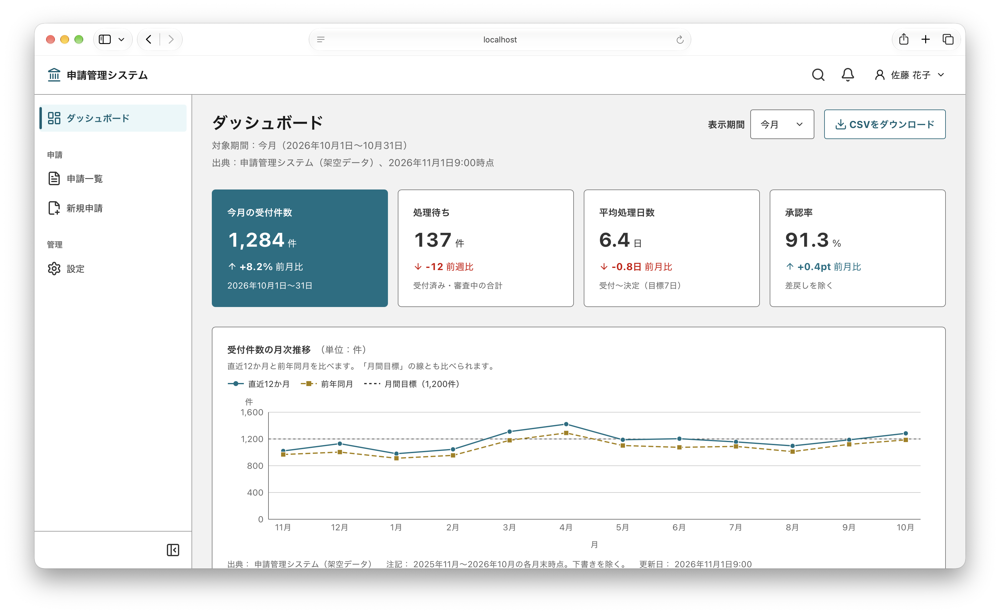
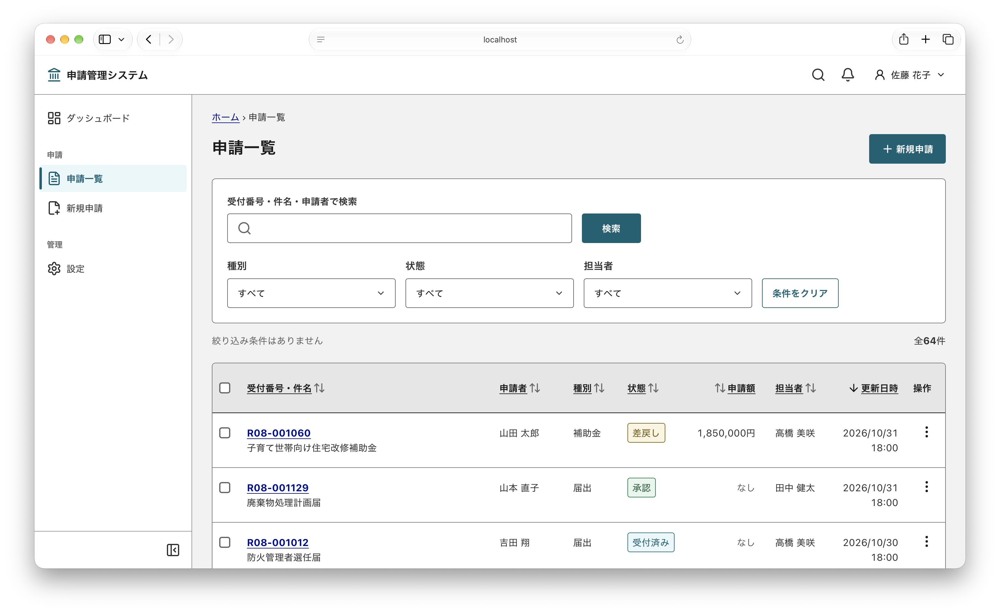
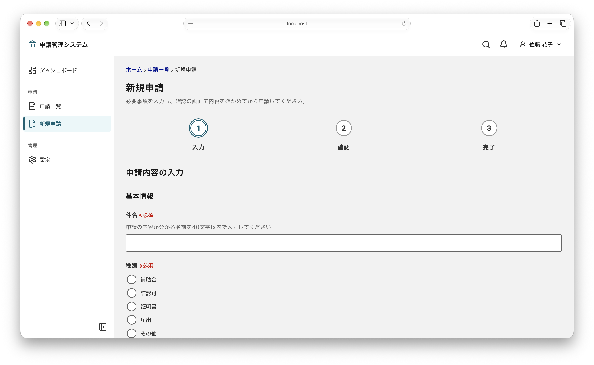
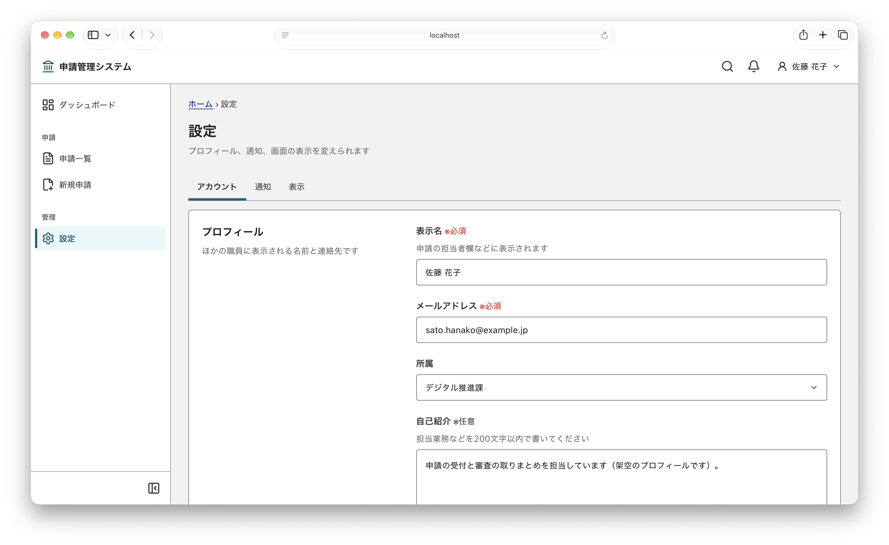

# Workspace UI Template (DADS)

[日本語](README.md) | English

An admin-dashboard frontend template that follows the [Digital Agency Design System (DADS)](https://design.digital.go.jp/dads/) of Japan. Built with Vite, React, TypeScript and Tailwind CSS v4.

**Demo**: [https://knk1313.github.io/workspace-ui-template-dads/](https://knk1313.github.io/workspace-ui-template-dads/) (deployed automatically from main)

All data and text on screen are fictional samples. No real API or backend is included; the screens run on a mock API in `src/api/`. This template is an independent implementation based on the public DADS specification and is not an official Digital Agency product.



| Application list | Create form | Settings |
| --- | --- | --- |
|  |  |  |

## What is included

- **Design tokens** (`src/tokens/`): values from `@digital-go-jp/design-tokens` 2.0.1 mapped into Tailwind's `@theme`. Tailwind's default palette and font sizes are disabled, so only tokens can be used.
- **About 55 UI components** (`src/components/ui/`) and **4 chart types** (`src/components/charts/`, wrapping Recharts). Each has unit tests and an axe check.
- **Two application shells**: sidebar layout (collapsible, drawer on mobile) and top navigation layout.
- **Sample screens**: dashboard, list, detail, create/edit form, settings, login, and 404/500.
- **Data and state**: a mock API layer with `useQuery` / `useMutation` (consistent loading, error and retry states), undo instead of confirmation for deletes, and a warning when leaving a form with unsaved changes. The settings screen can simulate failed or slow requests.
- **Checks**:
  - lint rejects hard-coded colours and arbitrary values;
  - token contrast tests (WCAG 2.2 AA);
  - Playwright E2E at desktop and mobile widths: axe, alignment of icons and controls, focus not hidden under the sticky header, 400% zoom reflow, text spacing, forced colours, and a keyboard-only flow;
  - visual regression tests run in the official Playwright Docker image.
- **Dark mode**: users choose light, dark or the OS setting on the settings screen. DADS defines no dark palette, so the dark colours are our own choice from the DADS tokens (`src/tokens/theme-dark.css`).
- **UI text**: wording follows the rules in [docs/ui-text.md](docs/ui-text.md) (Japanese).

## Setup

Node.js 22.22.2 or later in the 22 line, 24.15.0 or later in the 24 line, or 26 or later is required. Node.js 24 is recommended (see `.nvmrc`).

```bash
nvm use
npm install
npm run dev                  # http://localhost:5173
npm run check                # typecheck + lint + unit tests
npm run test:e2e:install     # first time only
npm run test:e2e
npm run test:visual          # visual regression (requires Docker)
npm run build
```

## Starting your own app

1. Change the app name and logo in `src/app.config.ts`.
2. Commit your changes, then run `npm run remove-samples`. It removes the sample screens, the sample API and data, and their tests, leaving a home page, settings, login and error pages. Run `npm run check`, `npm run test:e2e` and `npm run test:visual:update` afterwards.
3. Replace the functions in `src/api/` with real API calls. Keep the return types so the screens do not need to change. Screens require sign-in (`src/layouts/AppLayout.tsx`); in the sample, any email address and password work except `fail@example.jp`. The sample session is only a flag in the browser, so enforce permissions in your API.
4. To adapt the design to your organisation, edit `src/tokens/local.css`. It holds the key colour (`--color-key-*`; for example replace `blue` with `green`), link colours, font families, page spacing, per-component corner radii and shadows, and breakpoints. The key colour drives the primary, hover, selection, highlight and info colours in both light and dark mode. Run `npm run check`: values that break the DADS requirements (contrast, text size, target size, focus colour, elevation steps) fail the tests. See "ローカルデザインシステムとして調整する" in `docs/tokens.md`.

See the Japanese [README](README.md) for the component list, directory layout and details.

## License

- Token values in `src/tokens/` come from the Digital Agency's `@digital-go-jp/design-tokens` and `@digital-go-jp/tailwind-theme-plugin` (both MIT).
- The built files include React, React DOM, React Router and Recharts (MIT), and Lucide (ISC).
