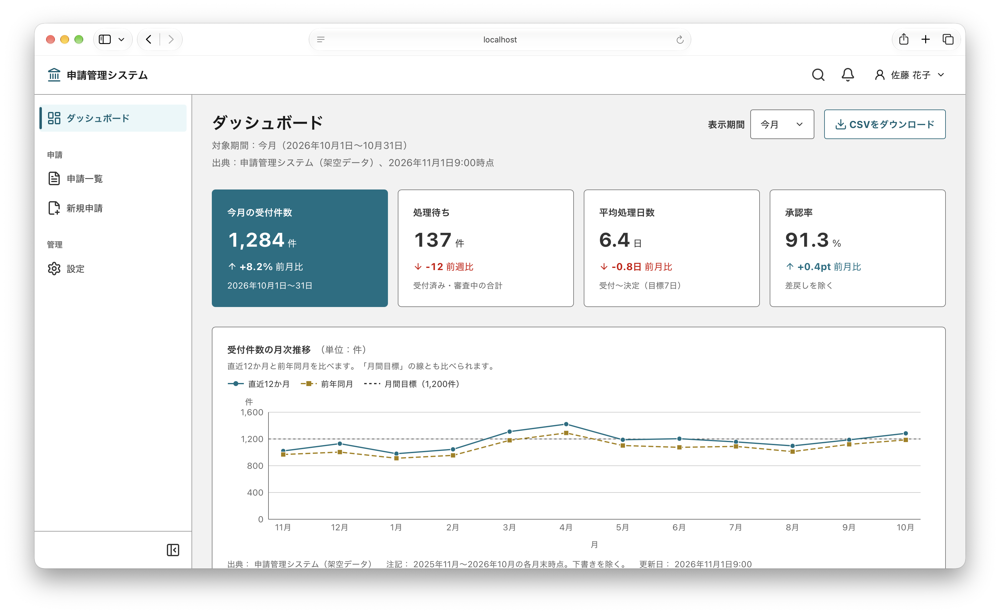
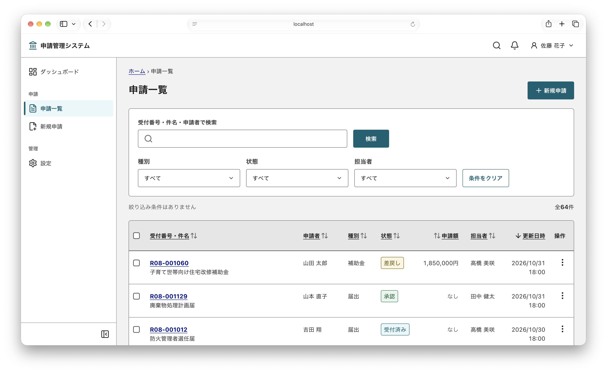
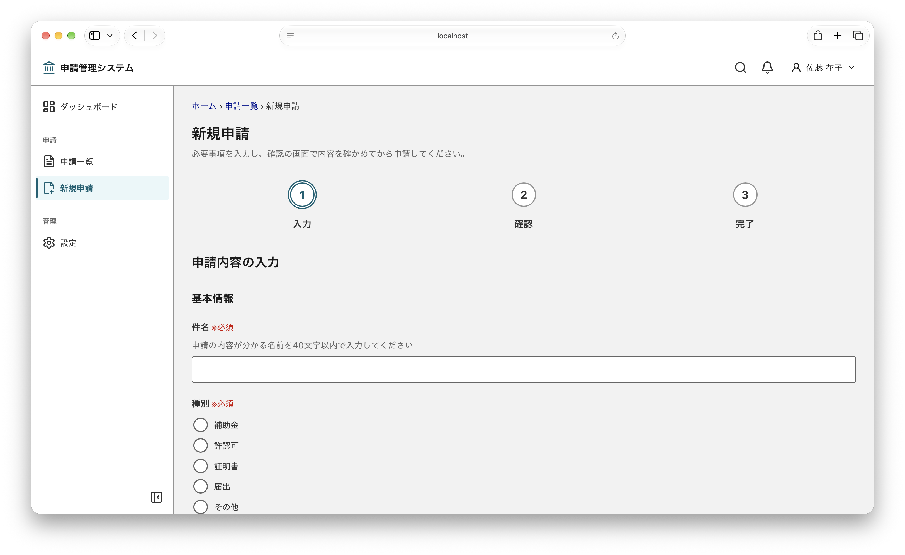
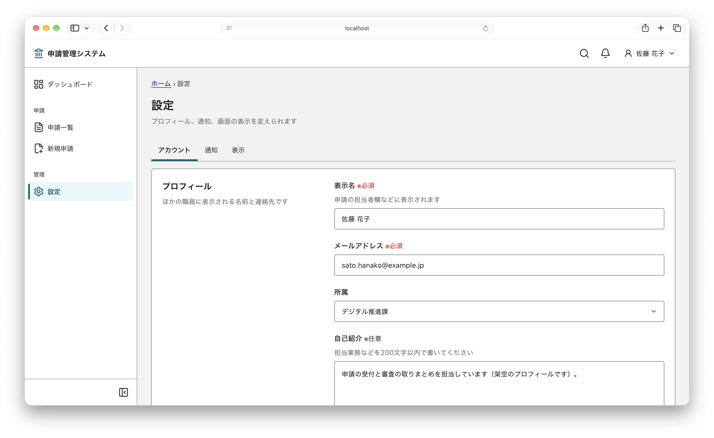

# Workspace UI Template（DADS準拠）

日本語 | [English](README.en.md)

[デジタル庁デザインシステム（DADS）](https://design.digital.go.jp/dads/)に準拠した、管理画面向けのフロントエンドのテンプレートです。Vite、React、TypeScript、Tailwind CSS v4で作っています。

**デモ**：[https://knk1313.github.io/workspace-ui-template-dads/](https://knk1313.github.io/workspace-ui-template-dads/)（mainの画面を自動で公開しています）

画面に出るデータと文章は、すべて架空の見本です。本物のAPIやバックエンドは含まず、`src/api/`のダミーのAPIで動きます。このテンプレートはデジタル庁の公式なものではありません。DADSの公開されている仕様を基に、独自に実装したものです。



| 申請一覧 | 作成フォーム | 設定 |
| --- | --- | --- |
|  |  |  |

## DADSへの準拠

- **デザイントークン**：色、文字の大きさ、行の高さ、角丸、影には、公式の`@digital-go-jp/design-tokens` 2.0.1の値を使っています。Tailwindの既定の色と文字の大きさは使えなくしてあり、トークン以外の色や寸法は書けません。
- **ローカルデザインシステム**：キーカラー、リンクの色、書体、余白、部品ごとの角丸と影、ブレークポイントは、`src/tokens/local.css`の1つのファイルで変えられます。変えた値がDADSの要件（コントラスト、文字の大きさ、タップ領域など）を満たすかは、テストで確かめます。今の値はDADSの既定から「信頼感・落ち着き」に寄せて刷新したもので、どの部品をどう変えたかは[docs/local-design-system.md](docs/local-design-system.md)にあります。
- **文字**：フォントは配信せず、OSの標準の書体を使います（DADSはNoto Sans JPを指定しています。理由は[docs/decisions.md](docs/decisions.md)のD-02）。本文は16px、行の高さは1.5を基準にし、14pxは補足だけに使います。14px未満は使いません。
- **フォーカスの表示**：DADSの形で、黒い4pxの枠に黄色い2pxの帯を重ねています。
- **ダークモード**：設定画面で、OSの設定に合わせるか、ライトかダークかを選べます。DADSにはダークモードの規定がないため、配色はDADSのトークンから独自に選んでいます。理由は、[docs/decisions.md](docs/decisions.md)のD-31に書いています。
- **コントラスト**：文字は4.5:1以上、部品の形とグラフは3:1以上です。トークンの組み合わせごとにテストで確かめ、実際のブラウザーでもaxeで検査しています。
- **部品**：DADSにある部品（ボタン、入力欄、表、通知のバナー、モーダルダイアログなど）は、公式のHTML版の寸法と状態の色に合わせています。DADSにない部品（トースト、ツールチップ、コマンドパレットなど）は、DADSのトークンを使い、WAI-ARIAの作り方の手引（APG）に沿って作っています。
- **ダッシュボード**：デジタル庁の『ダッシュボードデザインの実践ガイドブック』の画面の構成に沿っています。グラフは色だけに頼らず、数値の表と読み上げ用の説明を付けています。
- **画面の文言**：表記と言い回しを、[docs/ui-text.md](docs/ui-text.md)の文言表にまとめています。

## 技術の構成

用途ごとに使っているライブラリーとツールは、次のとおりです。

| 用途 | 使っているもの |
| --- | --- |
| ビルド | Vite 8、TypeScript 6 |
| 画面 | React 19、react-router 8（データルーター）、Tailwind CSS v4、lucide-react（アイコン） |
| グラフ | Recharts 3（`src/components/charts/`のラッパーからだけ使う） |
| テスト | Vitest、Testing Library、axe-core、Playwright、`@axe-core/playwright` |
| 検査 | ESLint 10、`scripts/check-design-tokens.mjs`（色コードと任意の値の直書きを見つける）、`scripts/check-playwright-image.mjs` |

## はじめ方

Node.jsは、22系なら22.22.2以上、24系なら24.15.0以上、または26以上が要ります。推奨はNode.js 24で、`.nvmrc`にも書いてあります。

```bash
nvm use
npm install
npm run dev               # http://localhost:5173
```

## 検査

```bash
npm run check              # 型、lint、単体テストをまとめて実行
npm run test:e2e           # E2E（初回は npm run test:e2e:install）
npm run test:visual        # 見た目の回帰テスト（Dockerが要る）
```

ほかのコマンドと、E2Eや見た目の回帰テストで確かめることは、[docs/testing.md](docs/testing.md)にあります。

## ディレクトリの構成

```text
src/
├── app.config.ts          # アプリ名、ロゴ、ナビゲーション、日付の表示の既定値
├── routes.tsx             # 画面のルーティング
├── App.tsx / main.tsx     # Providerとルーター
├── index.css              # Tailwindとトークンの読み込み、基本のスタイル、強制カラーモードのスタイル
├── tokens/                # デザイントークン（local.cssが導入先に合わせて変える入口）と、要件の検査
├── api/                   # ダミーのAPI、読み込みの仕組み（query.ts）、APIの型
├── components/
│   ├── ui/                # UIの部品（1部品＝1ファイルとテスト）
│   └── charts/            # Rechartsのラッパー
├── layouts/               # AppShell、TopNavLayout、ヘッダーの操作（アプリ固有の中身はheaderContent.ts）
├── pages/                 # 見本の画面（dashboard、applications、settings、auth、errors）
├── mocks/                 # 架空のデータ
├── context/ hooks/ lib/ test/
e2e/                       # Playwrightの検査（routes.tsが全画面の一覧、samples/が見本の画面の操作、visual/が見た目の回帰テスト）
scripts/                   # 検査のスクリプトと、見本の画面を消すスクリプト
```

## 自分のアプリにする

1. **アプリ名とロゴを変える**：`src/app.config.ts`の`name`、`description`、`logo`を書き換えます。ファビコンは`public/favicon.svg`です。
2. **見本の画面を消す**：変更をすべてコミットしてから、`npm run remove-samples`を実行します。
3. **画面を足す**：`src/pages/`に画面を作り、`src/routes.tsx`にルートを足します。ナビゲーションに出すときは、`src/app.config.ts`の`navigation`にも足します。E2Eで検査できるよう、`e2e/routes.ts`にも足します。
4. **データをつなぐ**：`src/api/`の関数の中身を、実際のAPIの呼び出しに差し替えます。詳しくは[docs/data.md](docs/data.md)にあります。
5. **色や形を変える**：`src/tokens/local.css`の値を書き換え、`npm run check`で要件の検査が通るかを確かめます。キーカラー、書体、行の高さ、余白、部品ごとの角丸と影、リンクの色、ブレークポイントがこのファイルにあります。手順と守る要件は[docs/local-design-system.md](docs/local-design-system.md)にあります。

見本の画面を消すと、ダッシュボード、申請の画面、申請のAPIとデータ、見本の画面の検査が消えます。ホーム、設定、ログイン、404、500の画面は残ります。消したあとは、次のコマンドで動くことを確かめ、見た目の回帰テストの基準画像を撮り直します。

```bash
npm run check
npm run test:e2e
npm run test:visual:update
```

## デプロイ

`npm run build`で、`dist/`に静的なファイルを出力します。サイトの直下ではない場所で配信するときは、`BASE_PATH=/パス/ npm run build`のように、配信するパスを渡します（デモは`.github/workflows/pages.yml`でこの形で公開しています）。ブラウザーの履歴を使うルーター（`createBrowserRouter`）なので、ホスティングの側で、存在しないパスにも`index.html`を返す設定が要ります。

## 文書

| 文書 | 内容 |
| --- | --- |
| [docs/screens-and-components.md](docs/screens-and-components.md) | 見本の画面と、部品の一覧 |
| [docs/data.md](docs/data.md) | データの読み書きの仕組みと、実際のAPIに置き換える方法 |
| [docs/testing.md](docs/testing.md) | 検査のコマンドと、それぞれが確かめること。依存パッケージの更新 |
| [docs/local-design-system.md](docs/local-design-system.md) | 導入先に合わせて値を変える手順と要件、DADSの既定から刷新した内容 |
| [docs/tokens.md](docs/tokens.md) | デザイントークンの一覧（色、文字、寸法） |
| [docs/decisions.md](docs/decisions.md) | DADSの資料に書かれていない点や、DADSと変えた点の判断の理由 |
| [docs/chart-guide.md](docs/chart-guide.md) | グラフの選び方（ダッシュボードデザインの実践ガイドブックの要約） |
| [docs/ui-text.md](docs/ui-text.md) | 画面の文言の一覧と、表記の方針 |
| [docs/accessibility.md](docs/accessibility.md) | スクリーンリーダーで読み上げを確かめる手順 |

## 参考資料

- [デジタル庁デザインシステム](https://www.digital.go.jp/policies/servicedesign/designsystem)（[β版のサイト](https://design.digital.go.jp/dads/)）
- [デジタル庁デザインシステムをどう使うか：導入先に合わせた「ローカルデザインシステム」を作る](https://digital-agency-news.digital.go.jp/articles/2026-11-26)（デジタル庁ニュース、2026年11月26日）
- [ダッシュボードデザインの実践ガイドブック](https://www.digital.go.jp/resources/dashboard-guidebook)
- [@digital-go-jp/design-tokens](https://github.com/digital-go-jp/design-tokens)（MIT License）

## ライセンス

- `src/tokens/`の色と文字の値は、デジタル庁が公開しているパッケージから写したものです。元のパッケージは`@digital-go-jp/design-tokens`と`@digital-go-jp/tailwind-theme-plugin`で、どちらもMIT Licenseです。
- ビルドしたファイルに含まれるライブラリーのライセンスは、次のとおりです。

| ライブラリー | ライセンス |
| --- | --- |
| React、React DOM、React Router、Recharts | MIT License |
| Lucide | ISC License |
