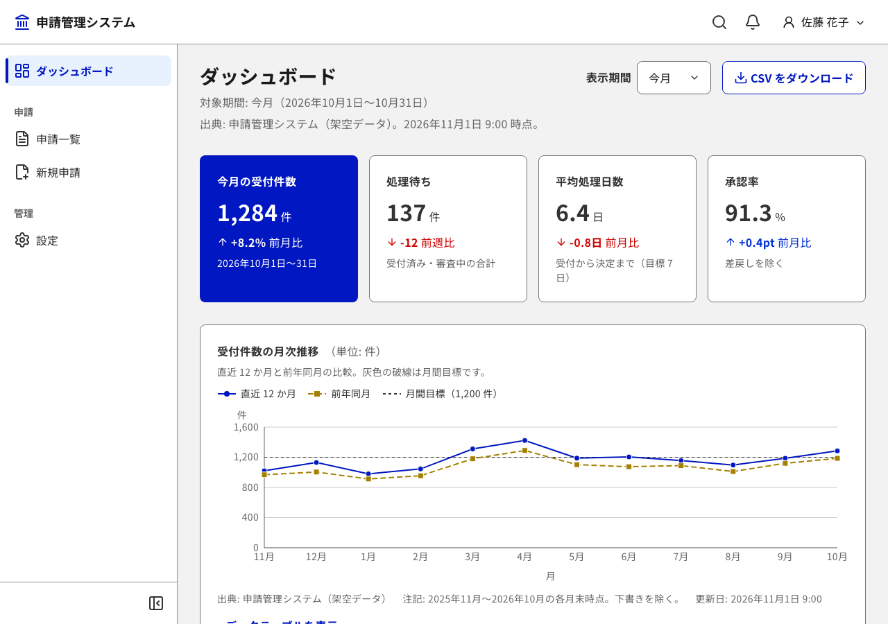
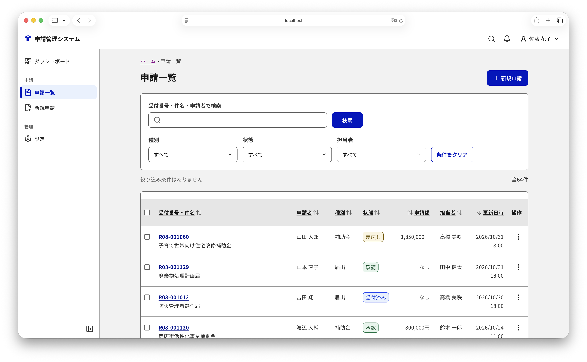
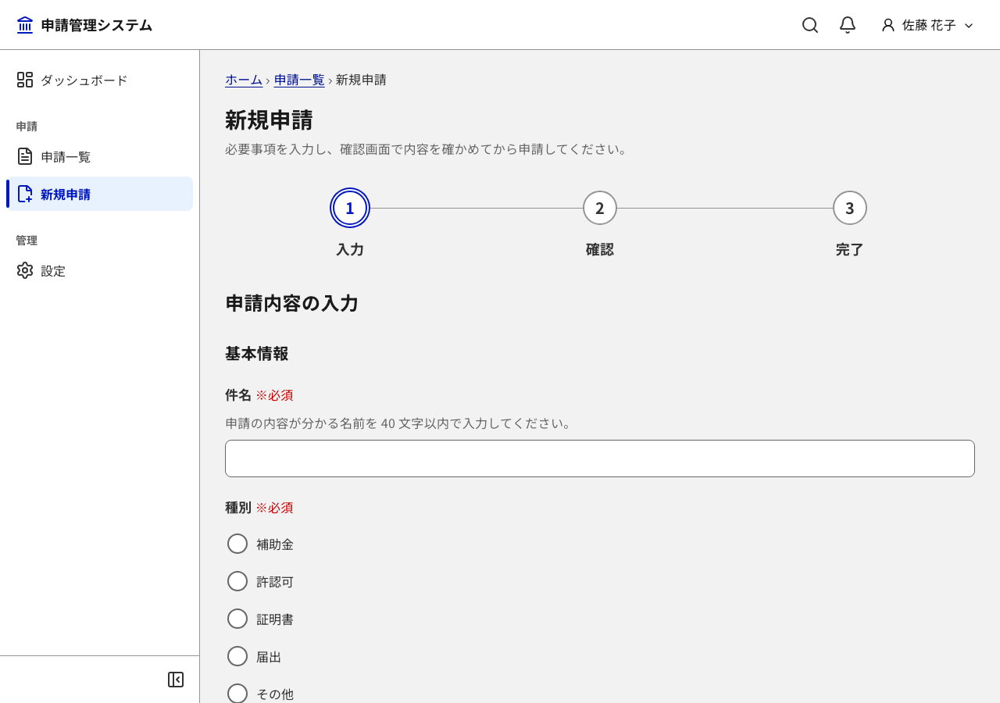
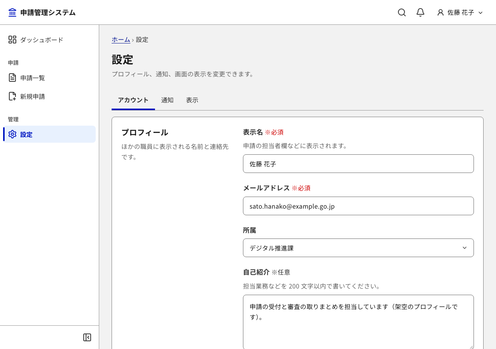

# Workspace UI Template（DADS準拠）

日本語 | [English](README.en.md)

[デジタル庁デザインシステム（DADS）](https://design.digital.go.jp/dads/)に準拠した、管理画面向けのフロントエンドのテンプレートです。Vite、React、TypeScript、Tailwind CSS v4で作っています。

画面に出るデータと文章は、すべて架空の見本です。本物のAPIやバックエンドは含まず、`src/api/`のダミーのAPIで動きます。このテンプレートはデジタル庁の公式なものではありません。DADSの公開されている仕様を基に、独自に実装したものです。



| 申請一覧 | 作成フォーム | 設定 |
| --- | --- | --- |
|  |  |  |

## DADSへの準拠

- **デザイントークン**：色、フォント、文字の大きさ、行の高さ、角丸、影には、公式の`@digital-go-jp/design-tokens` 2.0.1の値を使っています。Tailwindの既定の色と文字の大きさは使えなくしてあり、トークン以外の色や寸法は書けません。
- **文字**：Noto Sans JPを自前で配信します。本文は16pxを基準にし、14pxは補足だけに使います。14px未満は使いません。
- **フォーカスの表示**：DADSの、黒の4pxの枠と黄色の2pxの帯を重ねた形です。
- **コントラスト**：文字は4.5:1以上、部品の形とグラフは3:1以上です。トークンの組み合わせごとにテストで確かめ、実際のブラウザーでもaxeで検査しています。
- **部品**：DADSにある部品（ボタン、入力欄、表、通知のバナー、モーダルダイアログなど）は、公式のHTML版の寸法と状態の色に合わせています。DADSにない部品（トースト、ツールチップ、コマンドパレットなど）は、DADSのトークンを使い、WAI-ARIAの作り方の手引（APG）に沿って作っています。
- **ダッシュボード**：デジタル庁の「ダッシュボードデザインの実践ガイドブック」の画面の構成に沿っています。グラフは色だけに頼らず、数値の表と読み上げ用の説明を付けています。
- **画面の文言**：表記と言い回しを、[docs/ui-text.md](docs/ui-text.md)の文言表にまとめています。

## 技術の構成

| 用途 | 使っているもの |
| --- | --- |
| ビルド | Vite 8、TypeScript 6 |
| 画面 | React 19、react-router 8（データルーター）、Tailwind CSS v4、lucide-react（アイコン） |
| グラフ | Recharts 3（`src/components/charts/`のラッパーからだけ使う） |
| フォント | `@fontsource-variable/noto-sans-jp` |
| テスト | Vitest、Testing Library、axe-core、Playwright、`@axe-core/playwright` |
| 検査 | ESLint 9、`scripts/check-design-tokens.mjs`（色コードと任意の値の直書きを見つける）、`scripts/check-playwright-image.mjs` |

## はじめ方

Node.jsは、22系なら22.22.2以上、24系なら24.15.0以上、または26以上が要ります。推奨はNode.js 24で、`.nvmrc`にも書いてあります。

```bash
nvm use
npm install
npm run dev               # http://localhost:5173
```

## 画面（見本）

見本の画面と、主に使っている部品は次のとおりです。

| URL | 画面 | 主な部品 |
| --- | --- | --- |
| `/` | ダッシュボード | StatCard、LineChart、BarChart、DonutChart、DataTable、ActivityFeed |
| `/applications` | 一覧（検索、絞り込み、一括操作） | SearchBox、Select、ChipTag、DataTable、Pagination、DropdownMenu、ModalDialog、Drawer |
| `/applications/:id` | 詳細 | PageHeader、Tabs、DescriptionList、StackedList、Timeline、NotificationBanner |
| `/applications/new`、`/applications/:id/edit` | 作成と編集のフォーム（入力、確認、完了） | StepNavigation、FormField、Input、RadioGroup、DatePicker、Combobox、FileUpload、Switch、ActionPanel |
| `/settings` | 設定（設定画面の型のフォーム） | Tabs、FormSection、Switch、RadioGroup、Select |
| `/login` | ログイン | Card、Input、Checkbox、NotificationBanner |
| `*`、`/error/500` | 404、500 | ErrorPage |

ログイン、404、500の画面はナビゲーションに出ないため、設定の画面の末尾に、各画面へのリンクを置いています。画面のレイアウトは、設定の「表示」で「サイドバー型」と「上部ナビゲーション型」を切り替えられます。

## データと状態

画面は、`src/api/`の関数だけを通してデータを読み書きします。今はダミーのAPIです。データは画面を移っても残り、再読み込みすると初期値に戻ります。

- **読み込み**：`useQuery`（`src/api/query.ts`）で、読み込み中とエラーと再読み込みを、全画面で同じ形にしています。一度読み込んだ結果は、画面に戻ったときにすぐ表示し、裏で読み込み直します。
- **読み込めなかったとき**：エラーのバナーと「再読み込み」のボタン（`LoadError`）を出します。
- **保存と送信**：`useMutation`で処理中の表示を出し、二重に送らないようにします。失敗しても、入力した内容は消しません。
- **削除**：確認ダイアログを出さずにすぐ削除し、トーストの「元に戻す」で取り消せるようにしています。確認ダイアログを出すのは、取り消せない操作（アカウントの削除など）だけです。
- **入力途中の離脱**：保存していない変更があるまま画面を離れようとすると、確認を出します。仕組みは`useUnsavedChangesWarning`にあります。
- **失敗と遅延の見本**：設定の「表示」にある「動作の確認」で、通信を失敗させたり遅くしたりできます。エラーの表示と読み込み中の表示を確かめるときに使います。

実際のAPIに置き換えるときは、`src/api/applications.ts`と`src/api/settings.ts`の各関数の中身を`fetch`などに差し替えます。戻り値の型（`src/api/applicationTypes.ts`と`src/api/types.ts`）を保てば、画面は変えなくて済みます。

## 部品

部品はすべて`src/components/`にあります。使い方は、各ファイルの冒頭のコメント、Propsの型、同じ場所にある`*.test.tsx`を見てください。組み合わせ方は、見本の画面が参考になります。

| 分類 | 部品（`src/components/ui/`） |
| --- | --- |
| 要素 | Button、ButtonLink、ButtonAnchor、IconButton、ButtonGroup、Link、Anchor、Icon、Spinner |
| レイアウト | Container、Card（CardHeader、CardBody、CardFooter）、Panel、Divider、Heading、PageHeader |
| アプリケーションのシェル（`src/layouts/`） | AppShell（サイドバー型。折りたためて、モバイルではドロワーになる）、TopNavLayout（上部ナビゲーション型） |
| ナビゲーション | SideNav、HeaderNav、Breadcrumb、Tabs、Pagination、StepNavigation、CommandPalette |
| フォーム | FormField（ラベル、要否、サポートテキスト、エラー）、Input、Textarea、Select、Combobox、Checkbox、Radio、RadioGroup、Switch、DatePicker、FileUpload、SearchBox、FormLayout、FormSection、ActionPanel |
| データの表示 | Table、TableCellLine、DataTable（並べ替え、行の選択、一括操作、ページ送り、空の状態、読み込み中、横スクロール）、DescriptionList、StatCard、StackedList、GridList、ActivityFeed、Timeline、ChipLabel、StatusChip、ChipTag、Avatar、AvatarGroup |
| グラフ（`src/components/charts/`） | LineChart、BarChart（縦、横、積み上げ）、AreaChart（積み上げ、100%）、DonutChart、ChartFrame（凡例、単位、出典、注記、数値の表への切り替え） |
| フィードバック | NotificationBanner、Toast（useToast。「元に戻す」などの操作を付けられる）、LoadError、ModalDialog、ConfirmDialog（useConfirm）、Drawer、DropdownMenu、Popover、Tooltip、EmptyState、Skeleton、ErrorPage |

散布図は、ダッシュボードのガイドブックが勧めるグラフに含まれないため、用意していません。

## 検査

検査のコマンドは次のとおりです。

```bash
npm run typecheck          # 型の検査
npm run lint               # ESLint、デザイントークンの検査、PlaywrightのDockerイメージの版の検査
npm run test               # 単体テスト（全部品と全画面。axeとトークンのコントラストを含む）
npm run test:e2e:install   # 初回だけ：PlaywrightのChromiumを入れる
npm run test:e2e           # E2E（desktopとmobileの2つの幅）
npm run test:visual        # 見た目の回帰テスト（Dockerが要る）
npm run test:visual:update # 見た目の回帰テストの基準画像を撮り直す
npm run build              # 本番用のビルド（dist/）
npm run check              # typecheck、lint、testをまとめて実行
```

E2Eでは、表示と操作のほかに、次のことを確かめています。

- **axe**：全画面と、開いた状態（ダイアログ、メニュー、フォームのエラー）
- **整列**：アイコンやチェックボックスが、隣の文字の1行目と上下中央でそろっているか（1px以上のずれを見つける）
- **フォーカス**：Tabで移ったフォーカスが、固定のヘッダーの下に隠れないか
- **拡大と文字の間隔**：400%の拡大（幅320px）で横にはみ出さないか、文字の間隔を広げたときに文字が切れないか
- **強制カラーモード**：Windowsのハイコントラストなどで、スイッチとチェックボックスとタブの状態が見分けられるか
- **キーボード**：マウスを使わず、キーボードだけで申請を完了できるか

見た目の回帰テストでは、主な画面と開いた状態を撮り、基準画像と比べます。フォントの描画をそろえるため、手元とCIの両方で、PlaywrightのLinuxのイメージの中で撮ります（`scripts/visual.sh`）。画面を意図して変えたときは、`npm run test:visual:update`で基準画像を撮り直し、差分を見てからコミットしてください。

スクリーンリーダーでの読み上げは自動では確かめられないため、[docs/accessibility.md](docs/accessibility.md)の手順で人が確かめます。

## ディレクトリの構成

```text
src/
├── app.config.ts          # アプリ名、ロゴ、ナビゲーション、日付の表示の既定値
├── routes.tsx             # 画面のルーティング
├── App.tsx / main.tsx     # Providerとルーター
├── index.css              # Tailwindとフォントとトークンの読み込み、基本のスタイル、強制カラーモードのスタイル
├── tokens/                # デザイントークンと、コントラストの検査
├── api/                   # ダミーのAPI、読み込みの仕組み（query.ts）、APIの型
├── components/
│   ├── ui/                # UIの部品（1部品＝1ファイルとテスト）
│   └── charts/            # Rechartsのラッパー
├── layouts/               # AppShell、TopNavLayout、ヘッダーの操作（アプリ固有の中身はheaderContent.ts）
├── pages/                 # 見本の画面（dashboard、applications、settings、auth、errors）
├── mocks/                 # 架空のデータ
├── context/ hooks/ lib/ test/
e2e/                       # Playwrightの検査（routes.tsが全画面の一覧、samples/が見本の画面の操作、visual/が見た目の回帰テスト）
scripts/                   # 検査のスクリプトと、見本の画面を消すスクリプト
```

## 自分のアプリにする

1. **アプリ名とロゴを変える**：`src/app.config.ts`の`name`、`description`、`logo`を書き換えます。ファビコンは`public/favicon.svg`です。
2. **見本の画面を消す**：変更をすべてコミットしてから、`npm run remove-samples`を実行します。
3. **画面を足す**：`src/pages/`に画面を作り、`src/routes.tsx`にルートを足します。ナビゲーションに出すときは、`src/app.config.ts`の`navigation`にも足します。E2Eで検査できるよう、`e2e/routes.ts`にも足します。
4. **データをつなぐ**：`src/api/`の関数の中身を、実際のAPIの呼び出しに差し替えます。
5. **色を変える**：`src/tokens/theme.css`の「プライマリー」の8つのトークンを、同じ色相の段階でまとめて差し替えます。たとえば緑にするときは、`key-900`を`green-900`に、`key-1000`を`green-1000`にします。変えたら、`npm run test`でコントラストの検査が通るかを確かめ、`npm run test:visual:update`で基準画像を撮り直します。`green-500`のように明るすぎる色は、文字のコントラストが足りないため、検査で止まります。緑は成功を表す色にも使っているため、見分けが付くかも確かめてください。

見本の画面を消すと、ダッシュボード、申請の画面、申請のAPIとデータ、見本の画面の検査が消えます。ホーム、設定、ログイン、404、500の画面は残ります。消したあとは、次のコマンドで動くことを確かめ、見た目の回帰テストの基準画像を撮り直します。

```bash
npm run check
npm run test:e2e
npm run test:visual:update
```

## 依存パッケージの更新

Dependabot（`.github/dependabot.yml`）が、npmのパッケージを毎週、GitHub Actionsを毎月確かめます。Playwrightを上げるときは、`.github/workflows/ci.yml`のイメージの版も同じ版にし、基準画像を撮り直します。版がずれていると、`npm run lint`で止まります。

## デプロイ

`npm run build`で、`dist/`に静的なファイルを出力します。ブラウザーの履歴を使うルーター（`createBrowserRouter`）なので、ホスティングの側で、存在しないパスにも`index.html`を返す設定が要ります。

## 設計資料

設計にかかわる文書は次のとおりです。

| 文書 | 内容 |
| --- | --- |
| [docs/decisions.md](docs/decisions.md) | 判断の記録。DADSの資料に書かれていない点や、DADSと変えた点の理由 |
| [docs/tokens.md](docs/tokens.md) | デザイントークンの一覧（色、文字、寸法） |
| [docs/chart-guide.md](docs/chart-guide.md) | グラフの選び方（ダッシュボードデザインの実践ガイドブックの要約） |
| [docs/ui-text.md](docs/ui-text.md) | 画面の文言の一覧と、表記の方針 |
| [docs/accessibility.md](docs/accessibility.md) | スクリーンリーダーで読み上げを確かめる手順 |

## 参考資料

- [デジタル庁デザインシステム](https://www.digital.go.jp/policies/servicedesign/designsystem)（[β版のサイト](https://design.digital.go.jp/dads/)）
- [ダッシュボードデザインの実践ガイドブック](https://www.digital.go.jp/resources/dashboard-guidebook)
- [@digital-go-jp/design-tokens](https://github.com/digital-go-jp/design-tokens)（MIT License）

## ライセンス

[MIT License](LICENSE)です。セキュリティの問題の報告のしかたは、[SECURITY.md](SECURITY.md)にあります。

- `src/tokens/`の色と文字の値は、デジタル庁が公開しているパッケージから写したものです。元のパッケージは`@digital-go-jp/design-tokens`と`@digital-go-jp/tailwind-theme-plugin`で、どちらもMIT Licenseです。
- ビルドしたファイルに含まれるライブラリーのライセンスは、次のとおりです。

| ライブラリー | ライセンス |
| --- | --- |
| React、React DOM、React Router、Recharts | MIT License |
| Lucide | ISC License |
| Noto Sans JP | SIL Open Font License 1.1 |
